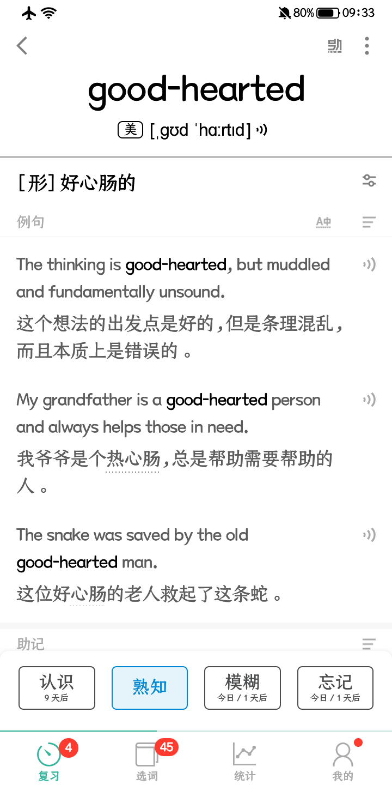
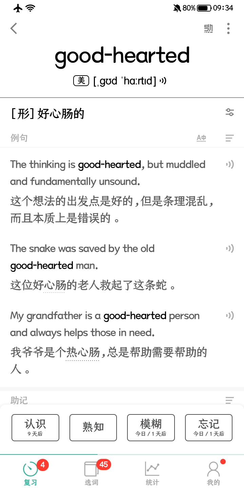

# 墨墨熟知按钮 (MOMO_familiar_button)


一个 LSPosed 模块：把墨墨背单词页面底部的 **三个** 按钮
`认识 / 不确定 / 不认识` 变成 **四个**
`认识 / 熟知 / 不确定 / 不认识`。





> 在真机（OPPO PLZ110 / Android 17 / KernelSU + LSPosed）上针对 **墨墨 5.6.00 (versionCode 900)** 实测通过；<br>
> 在 **海信 A5 Pro（HLTE203T / Android 10 / Magisk + LSPosed）** 上针对 **墨墨 5.6.05 (versionCode 904)** 实测通过。

---

## 效果

- 底部操作栏变成四等分：`认识`(绿) `熟知`(蓝) `不确定`(黄) `不认识`(红)
- `熟知` 的高度、圆角、按压态、字号字体与原生按钮一致
- 配色跟随界面主题：深色主题用浅蓝，浅色主题用深一点的蓝；**墨水屏设备自动转黑白**，与 App 自身在墨水屏上的黑白化保持一致
- 点击 `熟知` 走的是 App 自己的应答链路：
  `ReviewFragment.X0(ReviewResponse.WELL_FAMILIAR.value, false)`
  与 App 顶部工具栏的「熟知」图标、长按认识弹出的「标记熟知」是同一个入口
- 原有的三个按钮、滑动、拼写、确认弹窗都不受影响

## 安装

1. 手机需要 root + LSPosed
2. 安装 `MoMoRev.apk`（到 Releases 下载，或自己构建）
3. 打开 LSPosed 管理器 → 模块 → 启用「墨墨熟知按钮」
4. 在模块的**作用域**里勾选「墨墨背单词」
5. 强制停止墨墨背单词，再重新打开

## 构建

无需 Gradle：

```powershell
.\build.ps1
# 产物 build\MoMoRev.apk
```

依赖 JDK 17 + Android SDK build-tools 34（脚本里默认 `C:\AndroidDev\jdk-17`、`C:\AndroidDev\sdk`，
可以用 `-JdkHome` / `-SdkRoot` 覆盖）：

```powershell
.\build.ps1 -JdkHome "C:\Paths\java_jdk\jdk17" -SdkRoot "C:\Paths\Android_Path" -Install
```

`stubs/` 里是**编译期**用的 Xposed API 桩，不会打进 dex，运行时用 LSPosed 提供的真类。
版本号只在 `app/AndroidManifest.xml` 里维护，`build.ps1` 会读出来传给 aapt2。

## 更新日志

### v1.2

- 新增模块图标：猫头鹰 + 四个按钮（第二个实心），纯黑白，替代系统默认的安卓小人图标
- 图标提供 mdpi ~ xxxhdpi 五套密度

### v1.1

- 修复浅色主题下 `熟知` 显示成纯蓝色块、看不到文字
- 圆角与原生按钮对齐，四个按钮形状一致
- 墨水屏设备自动转黑白
- 已在海信 A5 Pro（Android 10）+ 墨墨 5.6.05 实测

### v1.0

- 首个版本，在 OPPO PLZ110（Android 17）+ 墨墨 5.6.00 实测

## 免责声明

仅供个人学习与逆向技术研究使用：

- 本仓库**不包含**墨墨背单词的任何代码、资源或安装包，只包含运行时注入的模块代码
- 不修改、不重打包原 App，不破解其付费内容
- 使用本模块可能违反该 App 的用户协议，由此产生的一切后果由使用者自行承担
- 请勿用于商业用途或二次分发
